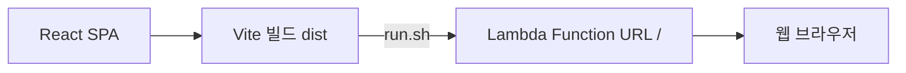

# React 웹 SPA 기술스택

2026-10-14 기준. `mobile/`의 React SPA를 Vite로 빌드하고, `run.sh`가 `dist/`를 Lambda에 함께 올려 Function URL의 `/`에서 서빙합니다. 네이티브 앱은 만들지 않습니다.



## 선택한 스택

| 역할 | 선택 | 버전·기준 |
|---|---|---|
| 언어 | TypeScript strict | 5.9.x: openapi-typescript 7의 peer dependency에 맞춤 |
| 빌드 | Vite | 8.x, 신규 스캐폴딩은 create-vite 9 |
| UI | React + React DOM | 19.x |
| 라우팅 | React Router | 7.x, Declarative 모드, `react-router` import |
| 서버 상태 | TanStack Query | 5.x: 사용자 조회·캐시, 로그인 mutation |
| 전역 클라이언트 상태 | Zustand | 5.x |
| 스타일 | Tailwind CSS | 4.x + Mobile UI Design System MCP (`--ds-*` 토큰, `#7c4dff`, 라이트/다크/시스템 테마) |
| Google 로그인 | `@capgo/capacitor-social-login` | 웹 구현만 사용. `@capacitor/core`는 이 플러그인의 peer dependency라서 남겨 둠 |
| 테스트 | Vitest + React Testing Library | jsdom에서 React DOM 동작 검증 |
| API 타입 | openapi-typescript | `docs/openapi.json` → `src/lib/schema.d.ts` |

설치된 정확한 버전은 `mobile/package-lock.json`이 기준입니다.

React Router의 SPA 구성은 [공식 Declarative 가이드](https://reactrouter.com/start/declarative/installation)를 따릅니다.

## 개발 환경

**Node.js 22.12+**를 사용합니다. `.nvmrc`는 22입니다. [Vite 요구사항](https://v8.vite.dev/guide/)

## 기존 저장소에서 개발

```bash
cd mobile
npm ci
cp .env.example .env.local
# API URL과 Google OAuth 웹 클라이언트 ID 입력
npm run dev

npm run api:types
npm run typecheck
npm run lint
npm test
npm run build           # dist 생성
```

`dist/`, 의존성, 로컬 환경변수는 커밋하지 않습니다. `/my` 등 직접 접속은 백엔드의 `SpaStaticFiles`가 `index.html`로 돌려줍니다.

## Google 로그인과 API

- `.env.local`의 `VITE_API_URL`에 백엔드 URL, `VITE_GOOGLE_WEB_CLIENT_ID`에 웹 OAuth 클라이언트 ID를 설정합니다. `VITE_*`는 번들에 노출되므로 비밀값을 넣지 않습니다.
- Google Cloud에서 웹 출처(개발은 `http://localhost:5173`, 운영은 Function URL)를 등록합니다. 웹 클라이언트의 승인된 리디렉션 URI에는 `http://localhost:5173/sign-in`과 운영 웹의 `/sign-in` URL도 등록합니다.
- `src/features/auth/google.ts`는 online 모드의 Google ID token을 받아 `POST /auth/google` 계약으로 전달합니다. 백엔드 `GOOGLE_WEB_CLIENT_ID`도 같은 웹 클라이언트 ID를 사용합니다.
- JWT로 `GET /me`를 호출해 세션을 복원합니다. 거절된 토큰은 지우고 로그인 화면으로 돌아갑니다. 로그아웃은 토큰·Google 세션·Query 캐시를 비웁니다.
- 토큰은 **암호화되지 않은 sessionStorage**에 두며 탭이 닫히면 세션이 종료됩니다. HttpOnly 쿠키 방식으로 바꾸려면 백엔드 계약 변경이 필요합니다.

설정은 [Google 로그인 가이드](https://capgo.app/docs/plugins/social-login/google/general/)를 따릅니다.

CORS는 Lambda Function URL의 SAM 설정 한 곳에서 관리합니다. 기본 허용 출처는 `http://localhost:5173`(웹 개발)입니다. 운영 웹은 같은 Function URL에서 서빙되므로 따로 등록할 필요가 없고, 다른 도메인에서 호스팅할 때만 SAM의 `AllowedOrigins` 파라미터에 추가합니다. 로컬 백엔드 서버는 없습니다. 웹 개발(`npm run dev`)과 운영 웹 빌드 모두 `VITE_API_URL`에 배포된 Function URL을 지정합니다. Function URL CORS가 `http://localhost:5173`을 허용하므로 프록시가 필요 없습니다.

## 모바일 웹 UX

- `viewport-fit=cover`와 `env(safe-area-inset-*)`로 노치·홈 인디케이터 영역을 피합니다.
- 버튼·탭에만 텍스트 선택·길게 누르기 메뉴 억제를 적용하고 입력·본문 복사와 포커스 표시를 유지합니다.
